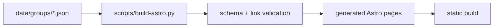

<div align="center">

# The Open Arena

**A free reference library for every sport on Earth.**

[](https://adineo-cmd.github.io/the-open-arena/)
   

[](https://github.com/adineo-cmd/the-open-arena/stargazers) [](https://github.com/adineo-cmd/the-open-arena/commits)

[Live site](https://adineo-cmd.github.io/the-open-arena/) · [Quick start](#quick-start) · [How it works](#how-it-works) · [Features](#features)

</div>

---

**119+ sports**, each with the same thirteen rooms: what it is, history, ways
to play, core skills and drills, the rules that matter, gear, training, the
pathway, competitions, legends, a first-week plan and a glossary.

Thirteen sport families and eleven training domains sit on top, with a hub,
an A–Z index and instant search.

## Features

| | Feature | What it does |
| --- | --- | --- |
| 🏟️ | **119+ sport guides** | One consistent structure across every sport, from football to fencing. |
| 🗂️ | **13 families** | Ball and team, racket, combat, endurance, water, winter, strength and more. |
| 🏋️ | **11 training domains** | The non-sport disciplines that build athletes, from mobility to nutrition. |
| 🔎 | **Instant search** | Client-side search over every page, with no search backend. |

## How it works

The content is JSON; the site is generated from it:

1. `data/groups/*.json` holds every sport and training domain.
2. `scripts/build-astro.py` validates and expands the data into Astro pages.
3. `npm run dev` and `npm run build` run that script automatically via
   `predev` / `prebuild`.
4. The builder fails loudly on schema errors, duplicate slugs or broken related
   links.



## Quick start

**Install and run**

```bash
npm install
npm run dev
```

**Production build**

```bash
npm run build
npm run preview
```

## Project structure

```text
data/
  groups/          sport and domain JSON
  examples/        the exemplar every sport follows
scripts/
  build-astro.py   data → pages
src/layouts/       shared shell
assets/css/        the single stylesheet
```

## Deployment

Every push to `main` builds the site and deploys it to GitHub Pages
through `.github/workflows/deploy.yml`:

**https://adineo-cmd.github.io/the-open-arena/**

The output is fully static — no server, no database, no runtime environment
variables.

## Rebuilding from data

```bash
python3 scripts/build-astro.py   # validate + generate
npm run dev                     # http://localhost:4321
npm run build
```

The Open Arena is the sister site of
[The Open Dojo](https://github.com/adineo-cmd/the-open-dojo), the martial-arts
library.
